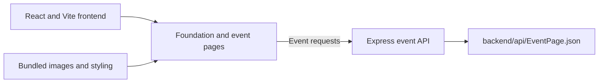

# VT-BIF Website

**A website project presenting the VIT-AP Technology Business Incubation Foundation.**

The application brings foundation information, startup profiles, team pages, and event content into a single interface. It demonstrates a React website backed by a small JSON-based event API.

[Existing demo link](https://clients-dco.pages.dev/) · [Frontend source](src/) · [Event API](backend/)

## Pages and features

- Home, about, team, startup, and contact pages.
- Event list and individual event detail routes.
- Shared navigation, loading screens, footer, and page components.
- Express endpoints serving event records from a JSON file.
- React Router, Tailwind CSS, and Flowbite React UI components.

The demo link is retained from the original project documentation; its current availability is not a guarantee of the source's runtime state.

## Architecture



## Run locally

Download and extract the repository. Start the frontend from the root:

```bash
npm install
npm run dev
```

Start the API in a second terminal:

```bash
cd backend
npm install
npm start
```

The API uses `PORT` when supplied and otherwise listens on **5000**. The frontend currently references a hosted event-service URL. Update the event fetch calls, including `src/pages/SinglePage.jsx` and the event-list components, to point to your local API when developing both parts together.

## API example

```bash
curl http://localhost:5000/EventPage
```

`GET /EventPage/:id` returns the corresponding event, or a 404 response when no matching ID is found. The API reads checked-in JSON; it is not backed by a database or content-management interface.

## Repository guide

| Path | Purpose |
|---|---|
| `src/pages/` | Route-level page composition |
| `src/components/` | Foundation, event, team, startup, and contact UI |
| `src/assets/` | Project images and graphics |
| `backend/index.js` | Express server and event endpoints |
| `backend/api/EventPage.json` | Event content |

## Current limitations

The contact form has no implemented message-delivery integration. The backend's `/assets/:filename` route references `path` without importing it and requires correction before use. Frontend `npm run build`, `npm run preview`, and `npm run lint` scripts are declared; the backend's test script is a placeholder.

## Credits and contributions

The site content presents VT-BIF at VIT-AP. Contributions should preserve the foundation's names and asset attribution, verify event links, and explain any changed API response shape. The backend package metadata declares ISC; no broader repository license is asserted here.
